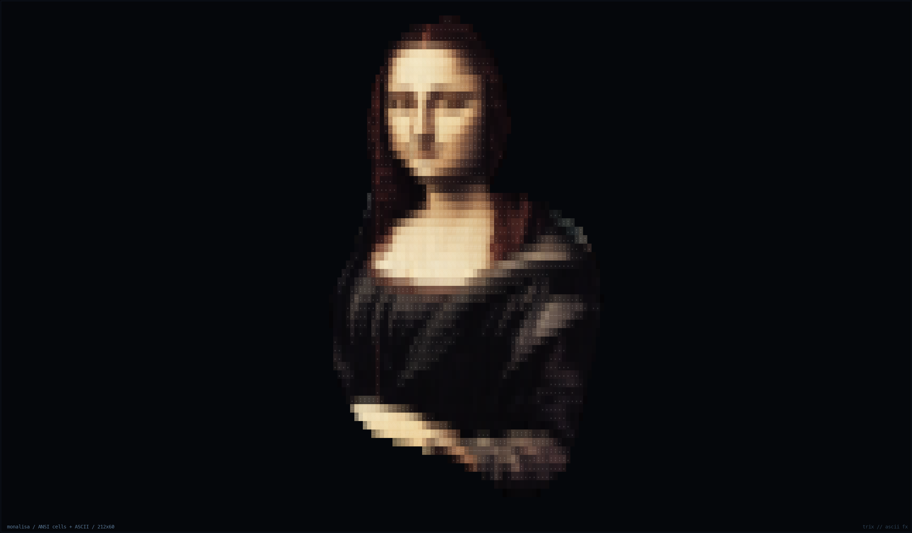
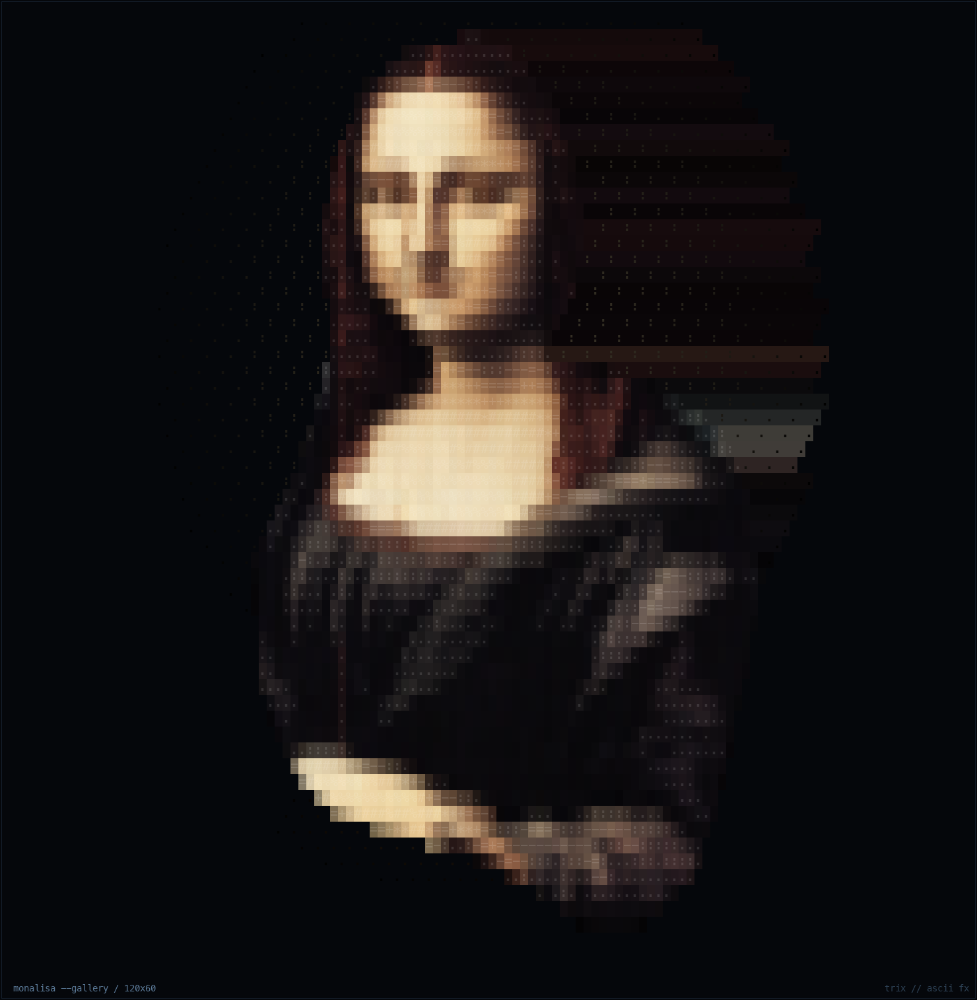
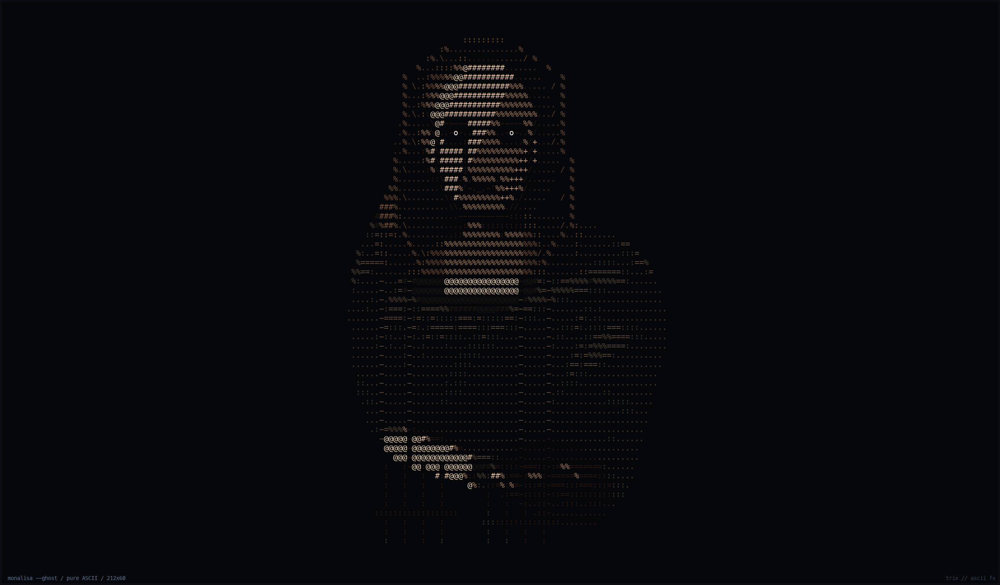
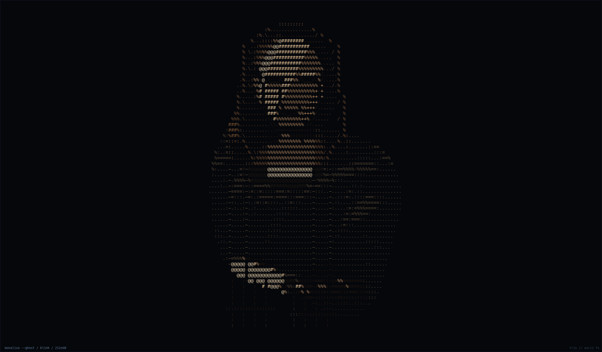

# 蒙娜丽莎（monalisa）v2 — 最终实现记录

> 状态：**已实施**。默认是 A（ANSI 色块 + ASCII 字符）；原来的纯字符“鬼影”版保留在 `--ghost`。

## 结果

| 模式 | 命令 | 画面 |
| --- | --- | --- |
| A（默认） | `trix monalisa` | 参考图烘焙的人物剪影；ANSI 色块承载肤色/头发/衣裙/手部，ASCII 字符勾细节；无山水、画框、浮尘；横向加宽约 12%；**静态，不眨眼** |
| B（鬼影版） | `trix monalisa --ghost` | 原来的纯 ASCII 字符画（77×56），只用前景色，不铺背景色块；眨眼 |

- 你的终端约 **212×60** 格：A 的人物约 66×60 格，B 保持 77×56 居中。
- A 的 `--unicode` 用 `▀`/`▄` 半块把垂直分辨率翻倍，脸和手更细腻；默认仍是 ASCII；A 本身不眨眼（`--ghost` 保留眨眼）。可选 `--gallery` 在人物后方加淡暖色展厅光晕与地面微光，默认关闭。

## 预览

| A（默认，212×60，静态） | A `--gallery` | B（`--ghost`） | B 眨眼 |
| --- | --- | --- |
|  |  |  |  |

早期对比：`compare.png`（旧版 vs A）、`b-vs-a.png`（参考 / B / A）。

## 实现

- `src/scenes/monalisa.rs`：A 的等比采样/色块 + 字符、Unicode 半块、A/B 模式切换、眨眼覆盖层。
- `src/data/monalisa.bin`：A 的 148×134 premultiplied RGBA 烘焙图（约 79 KB）。
- `src/data/monalisa_ascii.txt` + `monalisa_color.txt`：B 的 77×56 字符网格与 16 色索引。
- `tools/bake_monalisa.py`：从 `ref.webp` 裁切、抠图、去马赛克白缝、调色并打包 A。
- `tools/bake_monalisa_ascii.py`：生成 B 的字符网格与色号。
- Canvas 恢复 `Cell.bg` / `paint` / `set_bg` 与背景 SGR 差分；A 需要背景色块。

## 复现

```bash
python3 tools/bake_monalisa.py --preview /tmp/a.png
python3 tools/bake_monalisa_ascii.py --preview /tmp/b.png
cargo build --release
./target/release/trix monalisa --snapshot /tmp/a.ans --size 120x60 --frames 60 --seed 7
./target/release/trix monalisa --ghost --snapshot /tmp/b.ans --size 120x60 --frames 60 --seed 7
```

眨眼只属于 `--ghost`（seed 7：首次约 5.17 s，持续 0.33 s）；A 版本是静态的。
